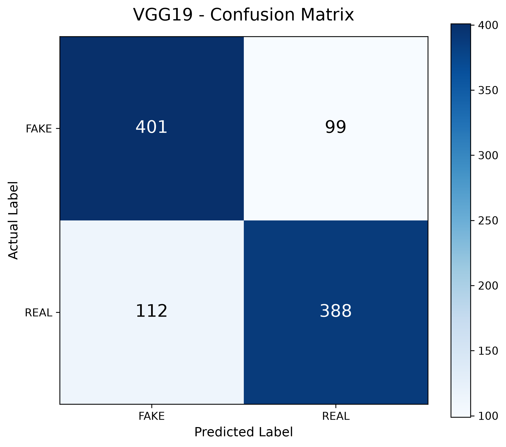

# Deepfake Detection System Using VGG19

## Project Overview

The Deepfake Detection System is a web-based application developed using Python, Flask, and the VGG19 deep learning model.

The system analyzes an uploaded face image and predicts whether the image is **Real or Fake**. It also displays the prediction confidence percentage to help users understand the model's output.

## Features

- Upload an image for deepfake detection.
- Detect real and fake face images.
- Uses the VGG19 deep learning architecture.
- Displays prediction results.
- Shows prediction confidence percentage.
- Provides a simple and user-friendly web interface.
- Displays model evaluation using a confusion matrix.

## Technologies Used

| Technology | Purpose |
|---|---|
| Python | Programming language |
| Flask | Web application framework |
| TensorFlow / Keras | Deep learning |
| VGG19 | Image classification model |
| HTML | Frontend structure |
| CSS | Frontend styling |
| NumPy | Numerical operations |
| Pillow | Image processing |
| Matplotlib | Confusion matrix visualization |

## Project Structure

```text
Deepfake-Detection-System/
│
├── Templates/
│   └── index.html
│
├── uploads/
│
├── app.py
├── train_vgg19.py
├── predict_image.py
├── evaluate_vgg19.py
├── plot_confusion_matrix.py
│
├── vgg19_deepfake_model.keras
├── vgg19_confusion_matrix.png
├── requirements.txt
├── README.md
└── .gitignore
```

## Installation and Setup

### 1. Clone the Repository

```bash
git clone https://github.com/hema-S-Programmer/Deepfake-Detection-System.git
```

### 2. Navigate to the Project Folder

```bash
cd Deepfake-Detection-System
```

### 3. Create a Virtual Environment

```bash
python -m venv vgg19_env
```

### 4. Activate the Virtual Environment

For Linux / Ubuntu:

```bash
source vgg19_env/bin/activate
```

For Windows:

```bash
vgg19_env\Scripts\activate
```

### 5. Install Required Libraries

```bash
pip install -r requirements.txt
```

### 6. Run the Application

```bash
python app.py
```

Open your browser and visit:

```text
http://127.0.0.1:5000/
```

## Model Evaluation

The project includes a confusion matrix to evaluate the classification performance of the VGG19 model.

**Confusion Matrix:**



## How the System Works

1. The user opens the web application.
2. The user uploads a face image.
3. The uploaded image is preprocessed.
4. The VGG19 model analyzes the image.
5. The system predicts whether the image is Real or Fake.
6. The prediction and confidence percentage are displayed.

## Future Enhancements

- Video-based deepfake detection.
- Improved model accuracy.
- Real-time deepfake detection.
- Enhanced user interface.
- Detailed prediction history.


GitHub: https://github.com/hema-S-Programmer


